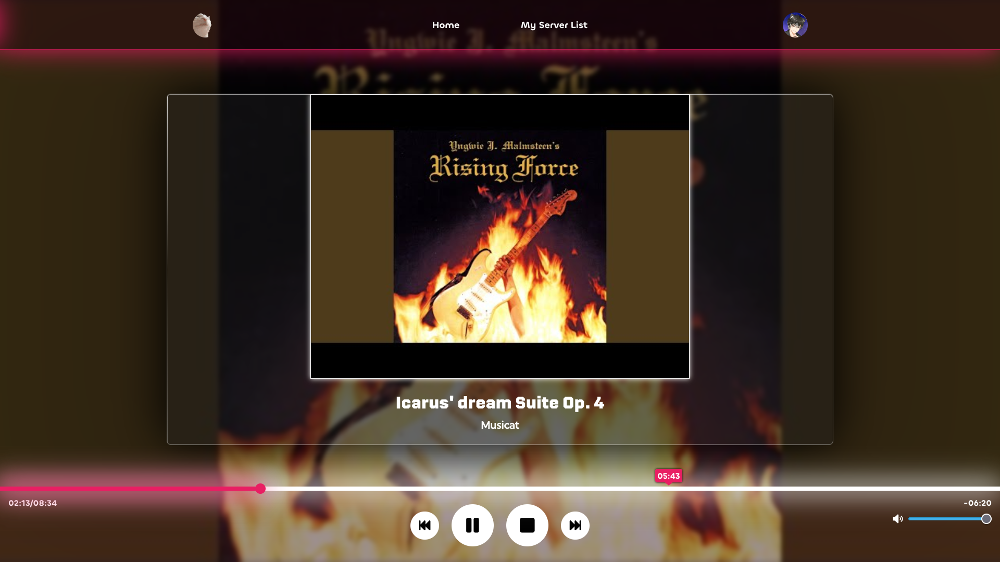

# Musicat Dashboard

Just a web player control for Musicat's voice channel session.

This Dashboard was made without much ideas in my mind, if anyone have any ideas feel free to create an issue or even PR.



## Setup

- Fill out `src/lib/config.ts`, see `src/lib/config.example.ts` for example

## Developing

Once you've created a project and installed dependencies with `npm install` (or `pnpm install` or `yarn`), start a development server:

```bash
npm run dev

# or start the server and open the app in a new browser tab
npm run dev -- --open
```

## Building

```bash
npm run build
```

You can preview the production build with `npm run preview`.

> To deploy your app, you may need to install an [adapter](https://kit.svelte.dev/docs/adapters) for your target environment.
